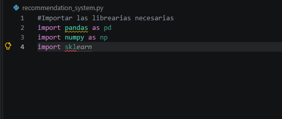
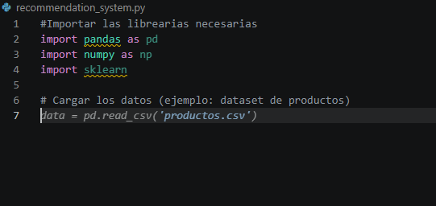
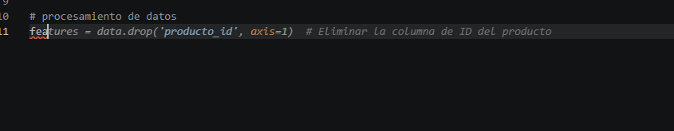
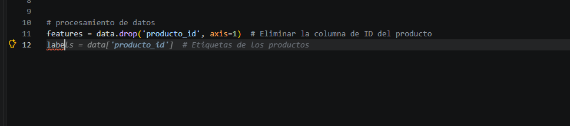
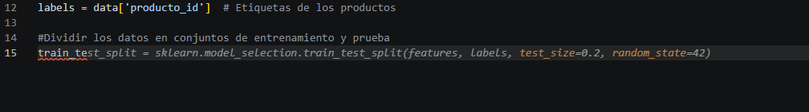
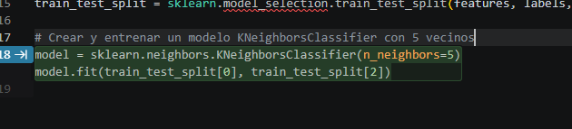
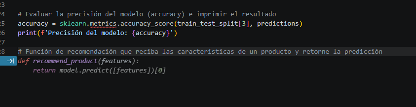
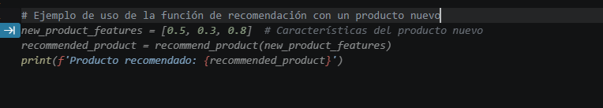

# AI_Project

## Introducción

Este proyecto documenta una actividad formativa de introducción a la inteligencia artificial. Durante la actividad se utilizó GitHub Copilot como asistente para generar y revisar un ejemplo básico de recomendaciones en Python mediante un modelo de clasificación K-Nearest Neighbors (KNN).

## 1. Configuración de la cuenta

Para comenzar, se solicitó una cuenta de estudiante de GitHub y se completó el proceso de validación de la condición académica en GitHub Education. La solicitud requirió iniciar sesión en GitHub, proporcionar la información académica solicitada y, cuando fue necesario, adjuntar documentación que acreditara la condición de estudiante. Una vez aprobada la validación, se comprobó que GitHub Copilot estuviera habilitado con el acceso gratuito correspondiente al plan educativo.

Finalmente, se inició sesión en Visual Studio Code con la misma cuenta y se verificó que la extensión de GitHub Copilot estuviera instalada y autenticada. Esto permitió recibir sugerencias de código dentro del editor durante la actividad.


## 2. Creación del repositorio

Desde GitHub se creó un repositorio llamado `AI_Project`. Después, se clonó el repositorio al equipo local para trabajar desde Visual Studio Code. La clonación se puede realizar desde la opción **Code** del repositorio copiando su URL y ejecutando `git clone <https://github.com/Luiis-mr/AI_Project.git>` en una terminal, o utilizando la opción **Clone Repository** de Visual Studio Code.

Una vez descargado el proyecto, se abrió la carpeta `AI_Project` en Visual Studio Code. Se confirmó que la carpeta local estuviera conectada al repositorio remoto correcto y que la rama de trabajo fuera `main`.

## 3. Desarrollo asistido por IA

En la carpeta del proyecto se creó el archivo `recommendation_system.py`. El código se elaboró de forma interactiva: se escribieron comentarios que describían cada tarea y GitHub Copilot propuso fragmentos de código a partir de ese contexto. Las sugerencias se revisaron y aceptaron en el editor.

El desarrollo siguió estas etapas:

1. **Importar las librerías.** Se añadieron `pandas` para leer y manipular los datos, `numpy` como librería de apoyo para operaciones numéricas y `sklearn` para separar los datos, entrenar el modelo y evaluar sus resultados.
2. **Cargar y preparar los datos.** El programa lee `productos.csv` con `pandas`. Para que este ejemplo funcione, el archivo debe estar disponible en la carpeta de trabajo y contener una columna `producto_id` junto con columnas numéricas que representen las características de cada producto. El código usa esas características como entradas (`features`) y `producto_id` como etiqueta (`labels`).
3. **Dividir el dataset.** Se utilizó `train_test_split` con `test_size=0.2` y `random_state=42`. Así, el 80 % de los registros se destina al entrenamiento y el 20 % a la prueba; la semilla fija hace reproducible la partición.
4. **Entrenar el clasificador.** Se creó un `KNeighborsClassifier` con `n_neighbors=5` y se entrenó con las características y etiquetas del conjunto de entrenamiento. El algoritmo utiliza los cinco vecinos más cercanos para asignar una clase.
5. **Evaluar el modelo.** El programa predice las etiquetas del conjunto de prueba y compara las predicciones con las etiquetas reales mediante `accuracy_score`. El resultado se imprime como la precisión del modelo. Esta métrica sirve como evaluación introductoria y no garantiza por sí sola la calidad de las recomendaciones.
6. **Crear una función de recomendación.** La función `recommend_product` recibe las características de un producto y devuelve la clase predicha por el modelo. Al final del archivo se muestra un ejemplo de llamada con un conjunto de características nuevo.

Las siguientes capturas muestran la secuencia de sugerencias y el código generado durante el desarrollo:

















## 4. Control de versiones

Cuando el archivo estuvo listo, se guardaron los cambios y se utilizó Git para registrarlos y publicarlos. Desde la terminal abierta en la carpeta del repositorio se ejecutaron los siguientes comandos:

```bash
git add recommendation_system.py
git commit -m "Add recommendation system example"
git push -u origin main
```

`git add` prepara el archivo para el commit; `git commit` guarda los cambios en el historial local con un mensaje descriptivo; y `git push -u origin main` publica el commit en la rama `main` del repositorio remoto y establece su seguimiento para futuros envíos. Por último, se revisó el repositorio en GitHub para confirmar que el archivo y el commit estuvieran disponibles.
